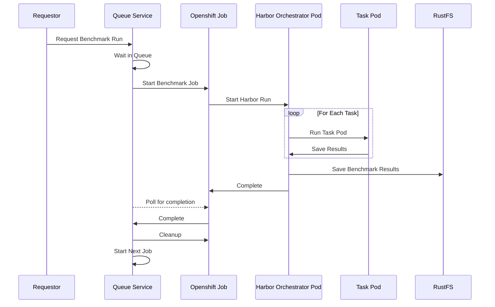

# Coding Agent Bench

Reproducible benchmarks for coding agents and models using Harbor

## Features

- Complete instructions for running popular benchmarks with open models
- CLI utility to simplify benchmark runs against self-hosted models
- Deployable queue service for scheduling benchmark runs in OpenShift 
- Leaderboards for popular benchmarks with instructions for reproducing results
- Full manifests for deploying open models on OpenShift with vLLM

## Table of Contents

- [Features](#features)
- [Leaderboards](#leaderboards)
  - [SWE-Bench Verified (pass@1, N=500)](#swe-bench-verified-pass1-n500)
  - [SWE-Bench Pro - Ansible Tasks (pass@1, N=96)](#swe-bench-pro---ansible-tasks-pass1-n96)
  - [Terminal Bench 2.0 (pass@1, N=87)](#terminal-bench-20-pass1-n87)
- [CLI Utility](#cli-utility)
  - [Prerequisites](#prerequisites)
  - [Run a Benchmark](#run-a-benchmark)
  - [Use Agent Skills](#use-agent-skills)
- [Queue Service](#queue-service)
  - [Set up the service](#set-up-the-service)
  - [Use the service](#use-the-service)
  - [(Optional) Connect to Nebius](#optional-connect-to-nebius)
  - [(Optional) Set Up the Intake Poller](#optional-set-up-the-intake-poller)
- [Harbor Command Examples](#harbor-command-examples)
  - [Claude Code vLLM](#claude-code-vllm)
  - [Codex vLLM](#codex-vllm)
  - [OpenClaw vLLM](#openclaw-vllm)
  - [OpenCode vLLM](#opencode-vllm)
  - [OpenHands vLLM](#openhands-vllm)
  - [Pi vLLM](#pi-vllm)
  - [Qwen Code vLLM](#qwen-code-vllm)
  - [Claude Code Anthropic](#claude-code-anthropic)
  - [Claude Code VertexAI](#claude-code-vertexai)
  - [Codex OpenAI](#codex-openai)
- [Deploy models with vLLM](#deploy-models-with-vllm)
- [SWE-Bench Acceleration](#swe-bench-acceleration)
  - [Use accelerated images for SWE-bench-verified](#use-accelerated-images-for-swe-bench-verified)
  - [Pre-pull base images](#pre-pull-base-images)
- [Run with Openshift](#run-with-openshift)
  - [Run Tasks in Openshift (Orchestrate Locally)](#run-tasks-in-openshift-orchestrate-locally)
  - [Run Tasks and Orchestrate in Openshift](#run-tasks-and-orchestrate-in-openshift)
- [Debugging Runs](#debugging-runs)
- [WIP](#wip)
  - [Run with Gemini and Gemini CLI](#run-with-gemini-and-gemini-cli)
  - [Run with vLLM and Gemini CLI](#run-with-vllm-and-gemini-cli)
- [Developers](#developers)
  - [Bumping the Project Version](#bumping-the-project-version)
  - [Deploying Changes](#deploying-changes)


## Leaderboards

<h3>✨ <a href="https://huggingface.co/spaces/taagarwa/coding-agent-leaderboard">Check out our Coding Agent Leaderboard on HuggingFace</a> ✨</h3>

### SWE-Bench Verified (pass@1, N=500)

| Model                          | Harness     | Score                                                            | Cost            |
| ------------------------------ | ----------- | ---------------------------------------------------------------- | --------------- |
| Opus 4.8                       | Claude Code | [86.8%](./benchmarks/SWE_Bench_Opus_4.8_Claude_Code.md)          | $395            |
| Opus 4.8                       | OpenCode    | [83.4%](./benchmarks/SWE_Bench_Opus_4.8_OpenCode.md)             | $320            |
| GPT 5.5                        | Codex       | [79.8%](./benchmarks/SWE_Bench_GPT_5.5_Codex.md)                 | $443            |
| Sonnet 4.6                     | Claude Code | [79.6%](https://www.anthropic.com/news/claude-sonnet-4-6)        | N/A             |
| RedHatAI/Qwen3.6-35B-A3B-NVFP4 | Pi          | [65.0%](./benchmarks/SWE_Bench_Qwen3.6_35b_NVFP4_Pi.md)          | $51<sup>†</sup> |
| RedHatAI/Qwen3.6-35B-A3B-NVFP4 | Qwen Code   | [63.8%](./benchmarks/SWE_Bench_Qwen3.6_35b_NVFP4_Qwen_Code.md)   | $37<sup>†</sup> |
| RedHatAI/Qwen3.6-35B-A3B-NVFP4 | Claude Code | [63.2%](./benchmarks/SWE_Bench_Qwen3.6_35b_NVFP4_Claude_Code.md) | $48<sup>†</sup> |
| RedHatAI/Qwen3.6-35B-A3B-NVFP4 | OpenClaw    | [58.8%](./benchmarks/SWE_Bench_Qwen3.6_35b_NVFP4_OpenClaw.md)    | $33<sup>†</sup> |
| RedHatAI/Qwen3.6-35B-A3B-NVFP4 | OpenCode    | [54.8%](./benchmarks/SWE_Bench_Qwen3.6_35b_NVFP4_OpenCode.md)    | $67<sup>†</sup> |


### SWE-Bench Pro - Ansible Tasks (pass@1, N=96)

| Model                          | Harness     | Score                                                                        | Cost            |
| ------------------------------ | ----------- | ---------------------------------------------------------------------------- | --------------- |
| Opus 4.8                       | OpenCode    | [78.1%](./benchmarks/SWE_Bench_Pro_Ansible_Opus_4.8_OpenCode.md)             | $151            |
| Opus 4.8                       | Claude Code | [69.8%](./benchmarks/SWE_Bench_Pro_Ansible_Opus_4.8_Claude_Code.md)          | $186            |
| GPT 5.5                        | Codex       | [60.4%](./benchmarks/SWE_Bench_Pro_Ansible_GPT_5.5_Codex.md)                 | $188            |
| GPT 5.5                        | OpenCode    | [57.3%](./benchmarks/SWE_Bench_Pro_Ansible_GPT_5.5_OpenCode.md)              | $111            |
| Opus 4.6                       | Claude Code | [51.0%](./benchmarks/SWE_Bench_Pro_Ansible_Opus_4.6_Claude_Code.md)          | $172            |
| Sonnet 4.6                     | Claude Code | [50.0%](./benchmarks/SWE_Bench_Pro_Ansible_Sonnet_4.6_Claude_Code.md)        | $184            |
| RedHatAI/Qwen3.6-35B-A3B-NVFP4 | Pi          | [47.9%](./benchmarks/SWE_Bench_Pro_Ansible_Qwen3.6_35b_NVFP4_Pi.md)          | $13<sup>†</sup> |
| RedHatAI/Qwen3.6-35B-A3B-NVFP4 | Claude Code | [45.6%](./benchmarks/SWE_Bench_Pro_Ansible_Qwen3.6_35b_NVFP4_Claude_Code.md) | $10<sup>†</sup> |
| RedHatAI/Qwen3.6-35B-A3B-NVFP4 | Qwen Code   | [43.8%](./benchmarks/SWE_Bench_Pro_Ansible_Qwen3.6_35b_NVFP4_Qwen_Code.md)   | $9<sup>†</sup>  |
| RedHatAI/Qwen3.6-35B-A3B-NVFP4 | OpenClaw    | [40.6%](./benchmarks/SWE_Bench_Pro_Ansible_Qwen3.6_35b_NVFP4_OpenClaw.md)    | $9<sup>†</sup>  |
| RedHatAI/Qwen3.6-35B-A3B-NVFP4 | OpenCode    | [37.5%](./benchmarks/SWE_Bench_Pro_Ansible_Qwen3.6_35b_NVFP4_OpenCode.md)    | $11<sup>†</sup> |


### Terminal Bench 2.0 (pass@1, N=87)

| Model                          | Harness  | Score                                                              | Cost            |
| ------------------------------ | -------- | ------------------------------------------------------------------ | --------------- |
| RedHatAI/Qwen3.6-35B-A3B-NVFP4 | Pi       | [36.0%](./benchmarks/Terminal_Bench_Qwen3.6_35b_NVFP4_Pi.md)       | $11<sup>†</sup> |
| RedHatAI/Qwen3.6-35B-A3B-NVFP4 | OpenCode | [30.3%](./benchmarks/Terminal_Bench_Qwen3.6_35b_NVFP4_OpenCode.md) | $11<sup>†</sup> |
| RedHatAI/Qwen3.6-35B-A3B-NVFP4 | OpenClaw | [20.2%](./benchmarks/Terminal_Bench_Qwen3.6_35b_NVFP4_OpenClaw.md) | $10<sup>†</sup> |


More coming soon...

<sup>†</sup> - Cost estimates for OSS models are calculated by ($4 per A100 GPU hour × agent benchmark duration).

## CLI Utility

The CLI utility will help you configure and run a benchmark jobs with Harbor for self-hosted models.
It automatically constructs and runs the Harbor job command for your specified benchmark, agent, self-hosted model.

### Prerequisites

- Install dependencies with uv
    
    ```bash
    uv sync
    ```

- [Set up a vLLM server](#deploy-models-with-vllm), or other Anthropic- and OpenAI-compatible server
- Select a benchmark from among the options in [Harbor Hub](https://hub.harborframework.com/)

### Run a Benchmark

The following is the minimal configuration needed to run a job with the CLI:

```sh
uv run coding-agent-bench run \
    --agent <agent> \
    --dataset <benchmark-name> \
    --model-name <model-name> \
    --server-url <server-url>
```

For example, to run `swe-bench/swe-bench-verified` in Claude Code against a self-hosted model:

```sh
uv run coding-agent-bench run \
    --agent claude-code \
    --dataset scale-ai/swe-bench-pro \
    --model-name my-model \
    --server-url http://my.server.url
```

If you want to see a preview of Harbor command that would be run for a given set of arguments without actually running the job, add the `--dry-run` flag.

> [!note]
> Additional configuration options are available, use `uv run coding-agent-bench run --help` to see them.

### Use Agent Skills

Pass one or more skill directories or Git sources with the repeatable `--skill`
option (`--skills` is an alias). Harbor installs the resolved skills into the
agent used by the benchmark.

To test a skill from your local filesystem:

```sh
uv run coding-agent-bench run \
    --agent opencode \
    --dataset swe-bench/swe-bench-verified \
    --model-name my-model \
    --server-url http://my.server.url \
    --skill ./my-skills
```

Git sources make skills easy to share and reproduce. Repeat the option to test
multiple skill collections, for example Superpowers together with Caveman:

```sh
uv run coding-agent-bench run \
    --agent claude-code \
    --dataset swe-bench/swe-bench-verified \
    --model-name my-model \
    --server-url http://my.server.url \
    --skill obra/superpowers \
    --skill juliusbrussee/caveman
```

Harbor accepts `org/name` and `org/name@ref` shorthand and HTTP(S) Git URLs.
Repository shorthand loads skills from the repository's `skills/` directory.
Use a full URL such as
`https://github.com/org/repo/tree/<ref>/<subdir>` to select another directory.
Pin a tag or named branch with `@ref` (or in the full URL) when comparing
benchmark runs. Harbor resolves the reference to a commit and records that
commit in the job lock file for reproducibility.

## Queue Service

The queue service is a FastAPI application that can be deployed on OpenShift to queue and run benchmarks automatically.
Benchmark results are stored in RustFS for later review.



### Set up the service

1. Log in to your cluster:

    ```sh
    oc login --server=<server> --token=<token>
    ```

2. Copy the Secret templates locally, fill in their values, and do not commit the resulting files:

    ```sh
    cp deploy/storage/base/secret.example.yaml deploy/storage/base/secret.yaml
    cp deploy/job-queue/base/secret.example.yaml deploy/job-queue/base/secret.yaml
    ```

    Apply the Secrets separately to the target project before deploying the services:

    ```sh
    oc apply -f deploy/storage/base/secret.yaml -n <project>
    oc apply -f deploy/job-queue/base/secret.yaml -n <project>
    ```

3. Deploy the RustFS storage service to store job artifacts:

    ```sh
    oc apply -k deploy/storage/overlays/prod -n <project>
    ```

4. Deploy the Job Queue service:

    ```sh
    oc apply -k deploy/job-queue/overlays/prod -n <project>
    ```

5. Get the route for the deployed API service:

    ```sh
    export JOB_QUEUE_URL="https://$(oc get route job-queue-route -n <project> --output jsonpath='{.spec.host}')"
    open $JOB_QUEUE_URL/docs
    ```

### Use the service

Queue up a new benchmark task. Skills submitted to the queue must be public Git
sources because the OpenShift job cannot access paths on the requestor's local
filesystem:

```sh
curl -X POST $JOB_QUEUE_URL/jobs \
    -d '{"job_name": "test", "agent": "pi", "dataset": "swe-bench/swe-bench-verified", "model_name": "qwen3.6-27b", "server_url": "<server-url>", "n_tasks": 1, "skills": ["obra/superpowers@<ref>"]}' \
    -H "Content-Type: application/json" \
    -H "X-API-Key: <your-api-key>"
```

```json
{
    "message":"Job created.",
    "job_id":"b5ef13c8-8909-4bf1-b5b1-43354e9f395c", 
    ... 
}
```

View the queued/running/completed tasks:

```sh
open $JOB_QUEUE_URL/ui
```

Or list them from the API:

```sh
curl $JOB_QUEUE_URL/jobs -H "X-API-Key: <your-api-key>"
```

### Run a GitHub-hosted dataset

In the job form's **Advanced Options**, enter a GitHub repository as
`owner/repository` or a full GitHub URL and, if needed, a branch, tag, or commit.
For a private repository, enter a
fine-grained GitHub token with read-only Contents access. Public repositories can
leave the token blank. The job pod downloads the repository directly from GitHub
when the job starts.

The optional token is sent in the `X-GitHub-Token` header, held only in queue
memory while waiting, and passed to the running pod over `oc exec` stdin. It is
not saved in SQLite, files, environment variables, commands, pod specs, Secrets,
or application logs. It is discarded after dataset preparation or cancellation;
the form clears it after submission. The queue API key (`X-API-Key`) is separate
and remains required for public and private datasets.

SQLite stores only a boolean indicating that a GitHub token was supplied; the
token itself is never persisted. This is treated conservatively as a possible
private-repository marker. After a preemption checkpoint, jobs with this marker
wait for manual resume and a fresh token instead of attempting an unauthenticated
automatic download. Public-repository jobs without a supplied token can still
resume automatically.

Git history and submodules are not included. **Dataset Directory in Repository**
defaults to `tasks`. Change it to a relative path to one Harbor task folder, or to a dataset
directory whose immediate child directories are Harbor tasks. For example, use
`benchmarks/my-dataset` if that contains `task-one/task.toml`,
`task-two/task.toml`, and so on. Leave it blank if the repository root itself
is the task or dataset directory. This follows Harbor's local `--path` format:
it checks for a task at the selected path, otherwise it enumerates its immediate
child directories as tasks. It does not search for a `tasks/` directory or infer
the location from a `dataset.toml` automatically.

Downloads are limited to 512 MiB compressed and 2 GiB unpacked within each job's
4 GiB ephemeral dataset volume. There is no archive staging on the queue server.
The pod finishes downloading, safely extracts the archive, and checks for valid
Harbor tasks before execution. Partial downloads and archives are deleted after
preparation; extracted data disappears when the pod is deleted.

The resolved Git commit is recorded with the repository and subdirectory before
Harbor starts. Resume re-downloads that exact commit into the new job pod, then
restores job results. Supply a fresh `X-GitHub-Token` header on
`POST /jobs/{job_id}/resume` for private repositories; the original token is not
retained. Paused jobs that used a token are excluded from automatic Nebius
recovery and remain available in the UI's manual-resume section, where you can
provide a fresh token. Jobs whose initial dataset preparation never completed
must be resubmitted. A queue restart can still adopt a running pod whose dataset
was already prepared. Public repositories can be downloaded again without
credentials.

API submissions use the same job fields as usual plus:

```json
{
  "github_dataset": {
    "repository_url": "https://github.com/owner/repository",
    "ref": "main",
    "subdirectory": "tasks"
  }
}
```

If `subdirectory` is omitted from an API request, it defaults to `tasks`; use
an empty string to select the repository root.

The GitHub token is an optional request header, never a JSON job field.

Cancel a running or queued job:

```sh
curl -X DELETE $JOB_QUEUE_URL/jobs/<job_id> -H "X-API-Key: <your-api-key>"
```

#### Resume snapshots in object storage

Resumed jobs keep recovery snapshots under
`s3://results-staging/<original-job-name>/<attempt>/` before syncing updated
artifacts to `s3://results/<original-job-name>/`.

After a successful resume and sync, manifest-owned staging objects for that job are removed
only when Harbor reports every trial completed, with no pending, running,
cancelled, or errored trials, and the current pod has no pause request. Paused,
failed, or incompletely synced runs retain their snapshots. A cleanup failure is
logged without failing the completed benchmark. Each new snapshot marker records
the exact job, attempt, and uploaded file names. Cleanup deletes only those keys,
so nested job names and unrelated objects remain intact. Legacy snapshots without
ownership manifests are retained. If deletion partially fails, its manifest stays
available for a later cleanup attempt.

A job stuck in `pausing` can be cancelled through `DELETE /jobs/<job_id>` when
OpenShift confirms its parent Job is absent or terminally failed and its checkpoint is still
unconfirmed. Cancellation is queued for workload cleanup and survives service
restarts; it does not mark the checkpoint as usable. Jobs with live parents,
or whose checkpoints are being finalized, remain protected from this path.
Jobs with legacy parents without cooperative-pause support are marked `failed`
with a checkpoint-unconfirmed error, stopping automatic retries. Their parents
and unuploaded local results are retained for manual recovery.

Paused-job recovery attempts are scheduled through the serial worker even while
other jobs are running. Recovery does not compete with an active job for the
shared Nebius instance, and a failed attempt leaves the job paused for a later retry.

The stage and production deployment overlays set `CODING_AGENT_BENCH_IMAGE` to
the queue's own image so benchmark and resume workers use matching code. When
running a custom queue image outside these overlays, set this variable to the
same image reference.

### (Optional) Connect to Nebius

The queue service supports starting and stopping vLLM server instances automatically using [Nebius](https://nebius.com/).
When enabled, the queue service will create a Nebius VM, SSH into the instance, start the vLLM server for the next model in the queue, run the benchmark job against that model, swap the running model for the next model in the queue, then spin down the Nebius VM when the queue is empty.

To connect the queue service to Nebius, first [set up an AI Cloud account](https://docs.nebius.com/signup-billing/sign-up).

After setting up the account, [install the CLI](https://docs.nebius.com/cli/install) and [login to your account](https://docs.nebius.com/cli/configure).

Then run the following commands to create a service account in your project:

```sh
# Create a service account
export SA_ID=$(nebius iam service-account create \
  --name <service_account_name> \
  --format json | jq -r '.metadata.id')

# Create and attach an authorized key to the service account
nebius iam auth-public-key generate \
  --service-account-id $SA_ID \
  --output ~/.nebius/$SA_ID-credentials.json
```

Once the service account is created, copy [`deploy/job-queue/base/nebius-secret.example.yaml`](./deploy/job-queue/base/nebius-secret.example.yaml), fill in its values, and apply it separately. Do not commit the resulting file:

```sh
cp deploy/job-queue/base/nebius-secret.example.yaml deploy/job-queue/base/nebius-secret.yaml
oc apply -f deploy/job-queue/base/nebius-secret.yaml -n <project>
```

```yaml
kind: Secret
metadata:
  name: nebius-secret
type: Opaque
stringData:
  NEBIUS_ENABLED: "1"
  NEBIUS_SERVICE_ACCOUNT_CREDS: |
    <service-account-file-content>
  NEBIUS_USER: <nebius-user>
  NEBIUS_PARENT_ID: <nebius-parent-id>
  NEBIUS_TENANT_ID: <nebius-tenant-id>
  NEBIUS_SERVICE_ACCOUNT_ID: <nebius-service-account-id>
  NEBIUS_SUBNET_ID: <nebius-subnet-id>
  NEBIUS_INSTANCE_NAME_PREFIX: job-queue-worker
  NEBIUS_IDLE_TIMEOUT_SECONDS: "600"
  HF_TOKEN: <hugging-face-token>
```

When creating a job, set `server_url` to `nebius-<resource>` to use a managed Nebius instance with the specified GPU resource (e.g. `nebius-h200`, `nebius-b200`). Available resources are defined in `RESOURCE_CONFIG_REGISTRY`.

#### Waiting for Nebius capacity

If a new job cannot allocate or start its VM because Nebius explicitly reports
a physical capacity shortage (such as `Not enough resources`), it stays
`queued` with **Waiting for Nebius capacity** in its status details. It retries
until capacity becomes available or the job is cancelled; there is no overall
capacity-wait deadline and these attempts do not consume preemption auto-resumes.
Between attempts, other eligible jobs can use the serial worker. By default
retries target the configured project only. CAB does not silently switch GPU
types or pricing policy; cross-region search requires explicit opt-in below.

- `NEBIUS_CAPACITY_RETRY_SECONDS` controls the delay after a failed attempt
  (default **60 seconds**, must be positive).
- `NEBIUS_CLI_TIMEOUT_SECONDS` bounds each Nebius CLI call (default **300
  seconds**, must be positive). Timed-out CLI subprocesses are killed/drained;
  an uncertain provisioning outcome is reconciled before another attempt.
- `NEBIUS_MODEL_START_TIMEOUT_SECONDS` bounds stopping the old model and waiting
  for the new model server's readiness output, including SSH retries (default
  **1800 seconds / 30 minutes**, must be positive). Expiry fails preparation and
  cleans up the known VM; it is not classified as a GPU capacity shortage.
- Quota, authentication, invalid configuration, and unrecognized CLI failures
  are not classified as capacity shortages; they still fail the job. A bare
  `RESOURCE_EXHAUSTED` response without capacity details is not sufficient to
  enable endless retries.
- Retry timestamps and attempt counts are persisted in SQLite and exposed as
  `nebius_retry_at` (Unix epoch seconds) and `nebius_retry_attempts` in job API
  responses. Waiting survives queue-service restarts. Matching partially
  created VMs are adopted rather than blindly deleted/recreated.
- GitHub tokens stay only in memory during a capacity wait. If the queue
  service restarts before a credential-requiring job starts, that job fails
  with instructions to resubmit with a fresh token; credentials are never
  written to SQLite.

The existing paused/preempted-job recovery remains separate from this
initial-provisioning retry path.

#### Unknown provisioning outcomes and the shared-pool guard

A timed-out create/start request can have succeeded remotely. CAB therefore
persists a single provisioning owner in SQLite before making provider changes,
and records mutating CLI requests before sending them. While that owner's
outcome is unresolved, **all other jobs remain queued**, including external
endpoints and requests for different hardware or another region. Reconciliation
gets dispatch priority so a VM cannot finish allocating and then sit idle behind
an unrelated external benchmark. Blocked jobs do not increment allocation-attempt counters.
An explicit capacity rejection releases the guard, allowing a different queued
hardware request to try its own allocation or an external-endpoint job to run.
If no VM is known to remain, that release also clears the waiter's job-level
placement claim atomically. The last attempted target stays in the pool record
for diagnostics, but does not reserve that region against other queued jobs.
Uncertain requests and rejected starts on existing VMs retain their placement
claims for recovery and cleanup.
SQLite also records confirmed vacancy separately from a missing legacy location,
so resume commands/checkpoints cannot recreate a released claim after restart.
Selecting a new placement clears that vacancy marker before provisioning. Older
rows default to unknown ownership rather than being assumed vacant.

The owner is reconciled on the usual retry interval. A visible, stable VM is
reused to finish preparing that job rather than creating another VM. A single
`NotFound` after an unconfirmed create/start is not treated as proof that the
request failed: CAB keeps waiting instead of issuing a duplicate create. There
is no arbitrary timeout that silently unlocks an uncertain pool; an outcome
that cannot be established requires operator reconciliation.

Cancellation retains the owner in `cancelling` until its VM is confirmed gone.
A known deletion can be settled by confirmed absence, including after a lost
delete response. Startup/idle cleanup do not discard the guard. It survives
queue-service restarts and also covers uncertain preemption-recovery starts.
Cancellations during read-only discovery, before any VM request or observation,
can finish normally because no provider mutation was sent.

The settled pool placement is also retained so an idle VM in a region that does
not support the next job's different hardware can be cleaned up before a new
allocation. Pending jobs do not each get their own VM. Changing single-region
project/name settings while a job retains a saved VM fails closed: restore the
saved configuration or reconcile the recorded VM manually.

Before starting another managed allocation, CAB also checks the VMs claimed by
other recoverable jobs. A paused job may retain a confirmed stopped VM/cache;
`RUNNING`, transitioning, or unreadable owner state defers the new managed job
without attempting allocation or increasing its attempt count.
Allocation, preemption recovery, placement exclusion, and cleanup use the same
`NebiusJobOwnership` interpretation of each durable job:

| Job record | Ownership interpretation |
| --- | --- |
| Saved placement | Claim that exact project/name |
| Confirmed vacant, no saved placement | No VM claim, even with a resume command/checkpoint |
| Resume command, checkpoint, or active recovery state without placement | Protect the legacy VM and inspect its state before another allocation/restart |
| Fresh queued intake without placement | No VM claim |
| Cancelling legacy row without recovery evidence | Protect the possible legacy owner; cancellation alone does not authorize deletion |

In regional mode a stopped owner's VM can be retained while a different target
is used. In single-region mode the fixed target stays reserved until its owner
releases it, even when stopped; another job cannot replace that owner's cache.
Before restarting a retained VM, recovery also retires a different completed
job's idle VM. The cleanup target is journaled in the pool guard separately from
the recovering job's placement. A lost delete response blocks dispatch until
reconciled, including after restart, rather than starting two VMs concurrently.

#### Inspecting a blocked pool

These endpoints require the queue's normal `X-API-Key` authentication:

```sh
curl -H "X-API-Key: $API_KEY" "$QUEUE_URL/nebius/pool"
curl -X POST -H "X-API-Key: $API_KEY" \
  "$QUEUE_URL/nebius/pool/reconcile/<owner-job-id>"
```

The read-only response contains the owner job ID, pool phase, last operation,
recorded location, next retry time, and status message. It contains no cloud
credentials or SSH command. The POST wakes the **same owner through the serial
worker**; it does not make a parallel cloud call or clear the guard. It rejects
a stale owner ID or an active worker and does not enqueue duplicate attempts.

For an unresolved request:

1. Inspect `/nebius/pool` and the owning job's error. Use the recorded project
   and VM name, rather than the CLI's default project, when inspecting Nebius:
   `nebius compute instance get-by-name --parent-id <project-id> --name <vm-name> --format json`.
2. Restore credentials/connectivity if queries are failing. Use the POST above
   to retry immediately rather than waiting for the persisted deadline.
3. To abandon the run, use the existing `DELETE /jobs/<owner-job-id>`. The owner
   remains `cancelling` until its VM cleanup is confirmed. Retry reconciliation
   after fixing any cleanup error.
4. A `NotFound` after a lost create/start response is still inconclusive. If no
   VM ever becomes visible, contact Nebius with the request/trace information
   from the CLI logs to establish the provider outcome. Do not delete the SQLite
   guard or assume elapsed time proves the request failed.

After manual/provider verification that **the recorded VM is absent and no
create/start operation remains pending**, an authenticated operator can resolve
that target explicitly:

```sh
curl -X POST -H "X-API-Key: $API_KEY" -H 'Content-Type: application/json' \
  "$QUEUE_URL/nebius/pool/resolve-absent/<owner-job-id>" \
  -d '{"operator":"your-name","reason":"Provider confirmed request finished without a VM; ticket/reference", "confirmed_absent":true}'
```

This requires the expected current owner and an idle worker. In one SQLite
transaction it saves the self-reported operator, reason, timestamp and original
guard in `nebius_pool_resolutions`, clears the absent target's ownership, and
releases the guard. Queued jobs retry after `NEBIUS_CAPACITY_RETRY_SECONDS`, so
other eligible jobs can proceed. Cancellation still finishes through the worker
to clean up any remaining benchmark workloads. If the guard targeted a different
idle VM during paused recovery, the paused job's own VM claim is preserved.
No provider calls are made by this endpoint. Automatic reconciliation never
unlocks merely because time passed or repeated lookups returned `NotFound`.

Nebius offers `--async` and `compute instance operation get --id <operation-id>`.
This implementation retains the existing synchronous CLI protocol; it does not
yet persist provider operation IDs or supply provider idempotency keys. Thus a
lost initial response with no visible VM may still need operator/provider
investigation before using the explicit absence-resolution endpoint.
No live allocation/failover test was performed for this change.

#### Lifecycle code organization

- `api.py` retains HTTP endpoints, `JobStore` and its migrations, serial-worker
  scheduling, and benchmark execution/checkpoint workflows.
- `nebius_pool.py` contains the single-project `NebiusOrchestrator` and the
  queue-facing `NebiusPool` coordinator: shared ownership interpretation,
  provisioning guard binding, reconciliation, and scoped cleanup. The queue
  supplies its existing store, backend and cleanup settings explicitly; the
  coordinator neither imports `api.py` nor owns a separate queue/state store.
- `nebius_utils.py` retains CLI/SSH operations and regional discovery/routing.
  Regional routing composes the single-project orchestrator through its existing
  factory argument, avoiding a circular dependency.
- `ProvisioningRecord` / `PoolPhase` in `nebius_utils.py` define guard transition
  rules. The existing SQLite schema remains readable; `mutation_seen` is the
  persisted legacy name for whether a VM is known to require possible cleanup.
- Create/start/stop/delete explicitly call `mutate_instance`; the generic CLI
  runner only executes requests and bounds subprocess lifetime. It does not
  infer which job-state transition to perform by parsing command tokens.
- `reconcile_placement` uses public project-scoped inspect/delete methods.
  `NebiusPool` coordinates these operations through the store's public methods;
  API code owns persistence and dispatch, not the orchestrator's private clients.
- `_next_dispatch` is the queue policy: guard owner first, otherwise the next
  due job, otherwise wait for a deadline or enqueue/cancel event. In-memory
  routing/model caches do not authorize releasing a durable guard.

#### Automatic regional discovery (optional)

Set `NEBIUS_DISCOVER_REGIONS=1` to let CAB discover regional projects and default
subnets through the Nebius CLI using **the queue's service account**, not an
operator's local login. No projects, subnets, IAM grants, or alternate GPU types
are created automatically. The service account needs tenant-level project
listing, project/subnet/platform read access, compute lifecycle permissions,
and permission to use networking/attach the configured service account in the
target projects. Local CLI access does not imply the queue has these grants.

- `NEBIUS_PROJECT_NAME_PREFIX` defaults to `default-`. Only matching project
  names are considered. Use `stage-` for stage-only discovery, or a distinct
  approved prefix to avoid crossing environments. Empty prefixes are rejected.
- `NEBIUS_REGIONS` is an optional comma-separated region allowlist, such as
  `us-central1,eu-west1,me-west1`. Omit it to search all matching regional
  projects accessible to the service account. CLI pagination is followed.
- A project is eligible only when its advertised platform/preset supports the
  requested GPU family and GPU count and it has one unambiguous `default-`
  subnet. The known `-a` platform variants are supported without changing the
  GPU family, count, or requested preemptible policy.
- Each round refreshes discovery and tries eligible locations sequentially,
  preferring an existing owned VM or a persisted pending placement. Allocation
  is the authoritative quota/capacity check, not a prediction from platform
  listings. Regional quota failures may be skipped in favor of another region;
  quota-only rounds fail rather than retry forever. Authentication/configuration
  failures are not treated as capacity shortages.
- If all usable targets lack capacity, the job remains queued and is eligible
  for another round after `NEBIUS_CAPACITY_RETRY_SECONDS`. The attempt counter
  increments **once per unsuccessful round**, not once per region. Other jobs
  can run between rounds, and cancellation remains available.
- An uncertain create/start timeout stops the round. CAB first reconciles that
  placement on the next attempt rather than risking a second allocation.
  Failed target VMs are cleaned up before advancing to another region.
- `nebius_location` in SQLite/job API responses records region, project, subnet,
  effective resource config, and the deterministic VM name **before** allocation.
  Monitoring, pause/resume, cancellation, and cleanup use that saved location
  even after a queue restart. Preempted VM stabilization stays in its saved
  region; a missing VM can be recreated via the regional search path.

Use a unique `NEBIUS_INSTANCE_NAME_PREFIX` for each queue deployment. Regional
VM names include region and a project hash; cleanup only targets these owned
names (plus the legacy single-region VM name for upgrades). Discovery alone
does **not** mean a GPU is free, and enabling it does not reserve capacity.
Cross-project sweeps run only as explicit startup cleanup when no recoverable
managed jobs exist. Per-job cleanup is limited to its saved placement, or to
verified legacy recovery, and re-checks other durable job claims before deleting
a VM. A new job cancelled before selecting a placement deletes no Nebius VM.
Legacy VMs retain their configured subnet even when discovery finds a different
default subnet in the same project.

### (Optional) Set Up the Intake Poller

The intake poller is an optional CronJob to pull requests from a Google Sheet and submit them to the job queue.
You can read more about this service in the [intake poller docs](./deploy/README.md#intake-poller).

First, copy the secret in [`deploy/intake-poller/secret.example.yaml`](./deploy/intake-poller/secret.example.yaml), fill in the values according to the [intake poller docs](./deploy/README.md#intake-poller), and apply it separately. Do not commit this file.

```sh
cp deploy/intake-poller/base/secret.example.yaml deploy/intake-poller/base/secret.yaml 
oc apply -f deploy/intake-poller/base/secret.yaml -n <project>
```

Then create the CronJob:

```sh
oc apply -k deploy/intake-poller/overlays/prod -n <project>
```

## Harbor Command Examples

**Prerequisites:**

- Install [Harbor](https://www.harborframework.com/docs/getting-started)
- [Set up a vLLM server](#deploy-models-with-vllm), or other Anthropic- and OpenAI-compatible server
- Set your benchmark in your environment from among the options in [Harbor Hub](https://hub.harborframework.com/), e.g.:

    ```bash
    export BENCHMARK='swe-bench/swe-bench-verified'
    ```

- If you need to filter tasks in your benchmark by name, add the `-i` flag with your glob pattern to your `harbor run` command, e.g. `-i "*ansible*"`

**Directory:**

| Harness     | Model Server | Example                        | Status    |
| ----------- | ------------ | ------------------------------ | --------- |
| Claude Code | vLLM         | [Link](#claude-code-vllm)      | Validated |
| Codex       | vLLM         | [Link](#codex-vllm)            | Testing   |
| OpenClaw    | vLLM         | [Link](#openclaw-vllm)         | Validated |
| OpenCode    | vLLM         | [Link](#opencode-vllm)         | Validated |
| OpenHands    | vLLM         | [Link](#openhands-vllm)         | Validated |
| Pi          | vLLM         | [Link](#pi-vllm)               | Validated |
| Qwen Code   | vLLM         | [Link](#qwen-code-vllm)        | Validated |
| Claude Code | Anthropic    | [Link](#claude-code-anthropic) | Validated |
| Claude Code | VertexAI     | [Link](#claude-code-vertexai)  | Validated |
| Codex       | OpenAI       | [Link](#codex-openai)          | Validated |

> [!note]
> To use with a locally hosted model (e.g. llama.cpp) use a vLLM example and set `SERVER_URL=http://host.docker.internal:<server-port>`

### Claude Code vLLM

Set the following variables in your environ:

```bash
export SERVER_URL=
export MODEL_NAME=
```

Then run:

```bash
harbor run --agent claude-code -d $BENCHMARK \
    --ae ANTHROPIC_BASE_URL=$SERVER_URL \
    --ae ANTHROPIC_API_KEY='sk-no-key-required' \
    --ae ANTHROPIC_MODEL=$MODEL_NAME \
    --ae ANTHROPIC_DEFAULT_OPUS_MODEL=$MODEL_NAME \
    --ae ANTHROPIC_DEFAULT_SONNET_MODEL=$MODEL_NAME \
    --ae ANTHROPIC_DEFAULT_HAIKU_MODEL=$MODEL_NAME
```

### Codex vLLM

Set the following variables in your environ:

```bash
export SERVER_URL=
export MODEL_NAME=
```

Use the utility script to create the `config.toml` file:

```bash
uv run scripts/codex_config_toml.py $MODEL_NAME $SERVER_URL
```

Then run:

```bash
harbor run --agent codex -d $BENCHMARK \
    -m vllm/$MODEL_NAME \
    --ae CODEX_HOME=/root/.codex/ \
    --mounts-json '[ { "type": "bind", "source":"/path/to/coding-agent-bench/config.toml", "target": "/root/.codex/config.toml" } ]'
```

### OpenClaw vLLM

Set the following variables in your environ:

```sh
export MODEL_NAME=
export SERVER_URL=
export OPENAI_BASE_URL=$SERVER_URL/v1
export OPENAI_API_KEY='NONE'
```

Then run:

```sh
harbor run --agent openclaw -p $DATASET_DIR/swe-bench-verified \
    -m openai/$MODEL_NAME \
    --agent-kwarg thinking=off \
    --n-concurrent 8
```

### OpenCode vLLM

Set the following variables in your environ:

```bash
export MODEL_NAME=
```

Set the content of your OpenCode config in your environ. Remember to replace the `<server-url>` with your vLLM server url and the `<model-name>` with your served model name:

```bash
export OPENCODE_CONFIG_CONTENT='{"$schema":"https://opencode.ai/config.json","model":"vllm/<model-name>","provider":{"vllm":{"npm":"@ai-sdk/openai-compatible","name":"vLLM","options":{"baseURL":"<server-url>"},"models":{"<model-name>":{"name":"<model-name>","limit":{"context":196500,"output":65500}}}}}}'
```

Then run:

```sh
harbor run --agent opencode -p $DATASET_DIR/swe-bench-verified \
    -m vllm/$MODEL_NAME \
    --ae "OPENCODE_CONFIG_CONTENT=$OPENCODE_CONFIG_CONTENT"
```

### OpenHands vLLM

Set the following variables in your environ:

```bash
export MODEL_NAME=
export SERVER_URL=
export LLM_API_KEY="NONE"
```

Then run:

```bash
harbor run -d $BENCHMARK \
  -a openhands-sdk \
  -m hosted_vllm/$MODEL_NAME \
  --ae HOSTED_VLLM_API_BASE=$SERVER_URL/v1
```

### Pi vLLM

Set the following variables in your environ:

```bash
export MODEL_NAME=
```

Create a `models.json` file with your vLLM server information:

```bash
export PI_MODELS_JSON='{ "providers": { "vllm": { "baseUrl": "<server-url>", "api": "openai-completions", "apiKey": "NONE", "models": [{ "id": "gemma4-26b", "name": "<model-name>", "contextWindow": 262000 }] } } }'
echo $PI_MODELS_JSON > models.json
```

Then run:

```bash
harbor run --agent pi -d $BENCHMARK \
    -m vllm/$MODEL_NAME \
    --ae PI_OFFLINE=1 \
    --ae PI_CODING_AGENT_DIR=/root/.pi/agent \
    --mounts-json '[ { "type": "bind", "source":"/path/to/models.json", "target": "/root/.pi/agent/models.json" } ]'
```

### Qwen Code vLLM

Set the following variables in your environ:

```bash
export MODEL_NAME=
export SERVER_URL=
export OPENAI_BASE_URL=$SERVER_URL/v1
export OPENAI_API_KEY='NONE'
```

Then run:

```bash
harbor run --agent qwen-coder -d $BENCHMARK \
    -i $DATASET_PATTERN \
    -m $MODEL_NAME
```

### Claude Code Anthropic

Copy `.env.example` to `.env` and set the following variables:

```
ANTHROPIC_API_KEY=
```

Then run:

```bash
set -a
source .env

harbor run --agent claude-code -d $BENCHMARK \
    -m claude-opus-4-8
```

### Claude Code VertexAI

Set the following variables in your environ:

```bash
export CLOUD_ML_REGION=
export ANTHROPIC_VERTEX_PROJECT_ID=
export ANTHROPIC_MODEL=
```

Then run:

```bash
harbor run --agent claude-code -d $BENCHMARK \
    --ae CLAUDE_CODE_USE_VERTEX=1 \
    --ae CLOUD_ML_REGION=$CLOUD_ML_REGION \
    --ae ANTHROPIC_VERTEX_PROJECT_ID=$ANTHROPIC_VERTEX_PROJECT_ID \
    --ae ANTHROPIC_MODEL=$ANTHROPIC_MODEL \
    --ae GOOGLE_APPLICATION_CREDENTIALS='/app/.config/gcloud/application_default_credentials.json' \
    --mounts-json '[ { "type": "bind", "source":"~/.config/gcloud/application_default_credentials.json", "target": "/app/.config/gcloud/application_default_credentials.json" } ]'
```

### Codex OpenAI

Copy `.env.example` to `.env` and set the following variables:

```
OPENAI_API_KEY=
```

Then run:

```bash
set -a
source .env

harbor run --agent codex -d $BENCHMARK \
    -m gpt-5.5
```

## Deploy models with vLLM

Check out [`deploy/qwen-all-in-one.yml`](./deploy/qwen-all-in-one.yml) for a sample vLLM deployment of [RedHatAI/Qwen3.6-35B-A3B-NVFP4](https://huggingface.co/RedHatAI/Qwen3.6-35B-A3B-NVFP4).

Apply to your cluster by running:

```sh
oc apply -f deploy/qwen-all-in-one.yml
```

## SWE-Bench Acceleration

### Use accelerated images for SWE-bench-verified

1. Download the SWE-Bench-Verified tasks

```sh
harbor download swe-bench/swe-bench-verified
```

2. Replace images with the accelerated ones from [Epoch AI](https://epoch.ai/blog/swebench-docker)

```sh
uv run scripts/replace_swe_bench_images.py <path-to-dataset>
```

### Pre-pull base images

1. Download the dataset

```sh
harbor download <dataset>
```

2. Pull all the base images

```sh
uv run scripts/pull_images.py <path-to-dataset>
```

## Run with Openshift

### Run Tasks in Openshift (Orchestrate Locally)

Login to your cluster and select a project:

```bash
oc login --token=<token> --server=<server>
oc project <project>
```

Create ServiceAccounts and RoleBindings to run tasks:

```bash
oc apply -f deploy/job-queue/base/harbor-task-sa.yaml
```

Then in your `harbor` command, add the flag:

```bash
--env openshift
```

### Run Tasks and Orchestrate in Openshift

Login to your cluster and select a project:

```bash
oc login --token=<token> --server=<server>
oc project <project>
```

Create ServiceAccounts and RoleBindings to run tasks and orchestrate:

```bash
oc apply -f deploy/job-queue/base/task-sa.yaml
oc apply -f deploy/job-queue/base/orchestrator-sa.yaml
```

Copy the storage secret, fill in the values, and apply it separately. Do not commit the resulting file:

```bash
cp deploy/storage/base/secret.example.yaml deploy/storage/base/secret.yaml
oc apply -f deploy/storage/base/secret.yaml -n <project>
```

Create the RustFS deployment to store your job results:

```bash
oc apply -k deploy/storage/overlays/prod
```

Using the CLI, start a job with the `--remote` flag enabled and set `--environment openshift`, e.g.:

```bash
uv run coding-agent-bench run \
    --agent claude-code \
    --dataset scale-ai/swe-bench-pro \
    --model-name my-model \
    --server-url http://my.server.url \
    --remote \
    --environment openshift
```

Skills used by a remote OpenShift Job must be public Git sources. Local paths
are rejected because they are not available inside the orchestrator pod. The
pod also needs outbound network access to the Git host.

```bash
uv run coding-agent-bench run \
    --agent claude-code \
    --dataset swe-bench/swe-bench-verified \
    --model-name my-model \
    --server-url http://my.server.url \
    --skill obra/superpowers@<ref> \
    --remote \
    --environment openshift
```

## Debugging Runs

Each run leaves the agent's raw trajectory at `jobs/<job>/<scenario>/agent/<agent>.txt`
(one JSON event per line). Render one readably by pointing at the scenario dir:

```sh
uv run scripts/manual/parse_agent_log.py jobs/<job-name>/<scenario>
```

Recognized logs: `claude-code.txt`, `opencode.txt`, `pi.txt`. Chain-of-thought is hidden
by default (`--show-reasoning` to include it) and tool output is capped at 1000 chars
(`--limit N`, `--limit 0` for everything).

## WIP

### Run with Gemini and Gemini CLI

```bash
export GOOGLE_CLOUD_PROJECT="<your-project>"

harbor run --agent gemini-cli -d $BENCHMARK \
    -m $MODEL_NAME
```

### Run with vLLM and Gemini CLI

```bash
harbor run --agent gemini-cli -d $BENCHMARK \
    --ae GOOGLE_GEMINI_BASE_URL=$SERVER_URL \
    --ae GEMINI_MODEL=$MODEL_NAME \
    -m $MODEL_NAME
```

## Developers

### Bumping the Project Version

Version bumping is managed with `bump-my-version`.

First, create a new release branch for your version (e.g. v1.2.3)

```sh
git checkout -b release/v1.2.3
```

Bump the major/minor/patch version with

```sh
bump-my-version bump <major/minor/patch>
```

Then push the changes to the remote repository

```sh
git push origin release/v1.2.3
git push origin v1.2.3
```

Once merged, the CI will automatically build a new image tagged for the version and push it to GHCR.

### Deploying Changes

Three things need to happen before changes can be seen in the job queue service or other deployed resources:

1. The changes need to be merged into the main branch
2. The main branch needs to be [version bumped](#bumping-the-project-version), a PR created and merged, and an image for the new version successfully built
3. The job queue service and other resources need to be manually redeployed
