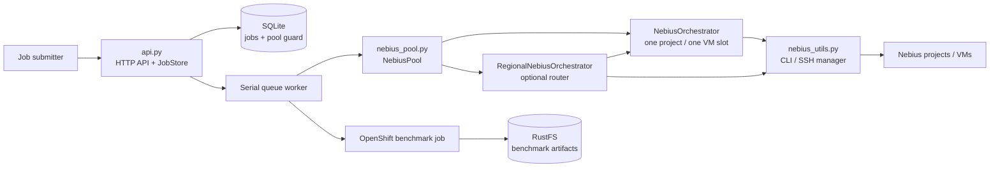
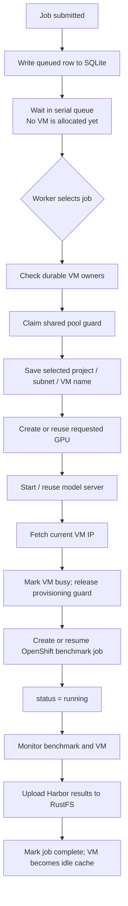
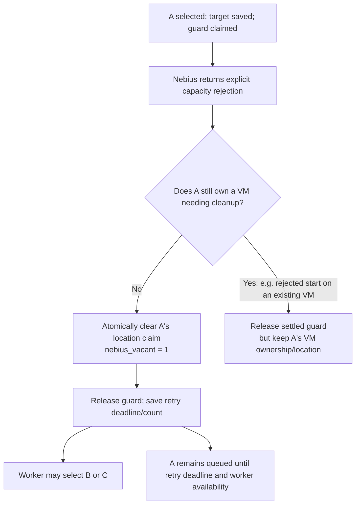
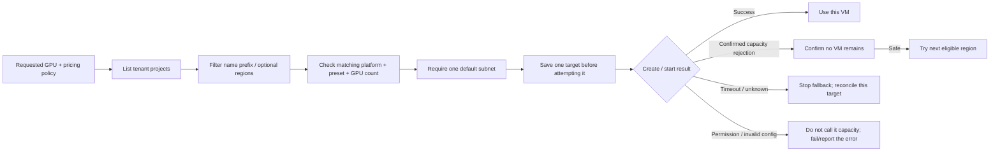
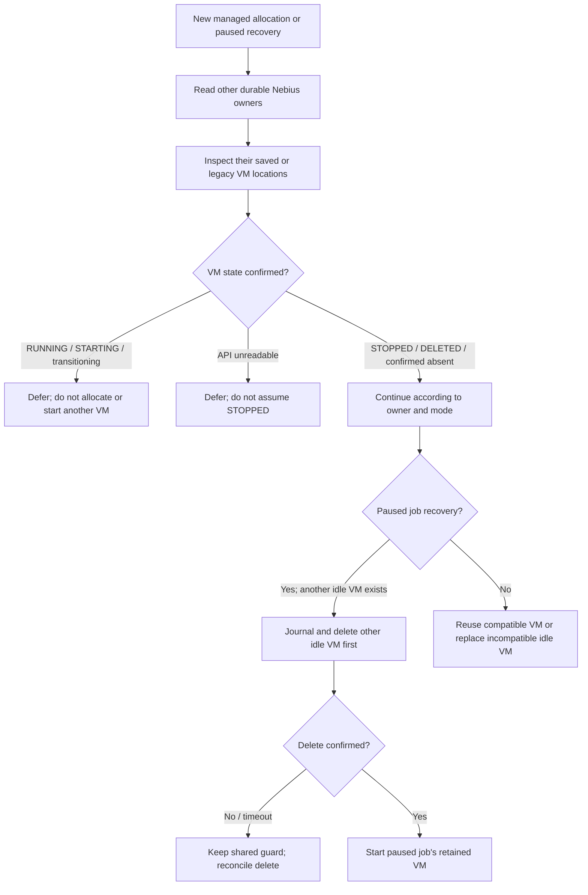
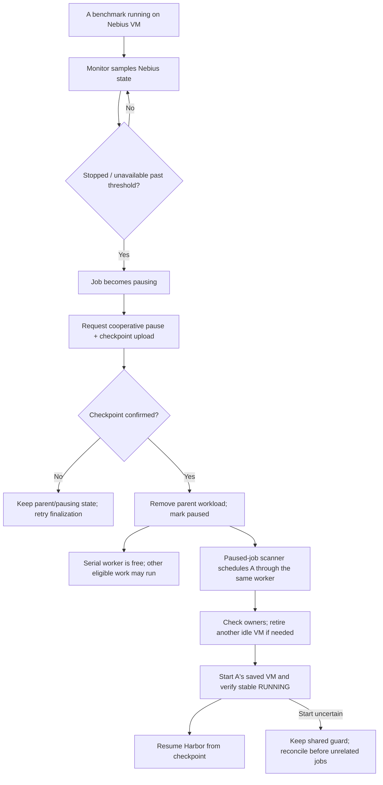
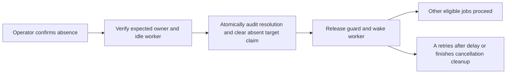

# CAB Nebius capacity and recovery — visual guide

This guide explains the workflow implemented by [PR #122](https://github.com/redhat-et/coding_agent_bench/pull/122), at commit `6990417`.

> **Diagrams and output snippets are illustrative.** Project IDs, VM names, timestamps, provider errors, and IPs will differ in a real run.

## 1. The moving parts



| Code | What it owns |
|---|---|
| `api.py` | HTTP endpoints, SQLite persistence, the serial dispatcher, benchmark execution, and checkpoint/preemption flow. |
| `nebius_pool.py` | VM ownership interpretation, shared guard coordination, reconciliation, single-project orchestration, and scoped cleanup. It receives the existing store and backend; it creates no second queue or database. |
| `nebius_utils.py` | Nebius CLI and SSH calls, typed errors, durable mutation notifications, and optional regional discovery/routing. |

**Important:** The `RegionalNebiusOrchestrator` routes project-specific calls to child `NebiusOrchestrator`s. It does not create an independent job queue or permit unrelated jobs to provision concurrently.

## 2. Normal queue and successful job



1. A submitted job is saved as `queued`. **Queueing alone never allocates a VM.**
2. The worker selects one eligible job. CAB persists its target and guard before a mutating provider request.
3. The orchestrator matches the requested GPU family/count; it does not silently substitute different hardware.
4. CAB starts the requested model and fetches the VM's current IP. It then supplies the real endpoint to the benchmark job.
5. The worker is serial. Releasing the provider guard after model preparation does not make another benchmark run concurrently; the worker is still occupied by this one.
6. After completion, the VM may remain as an idle cache for the existing 600-second idle timeout. That VM can still incur compute charges while retained.

Representative status progression:

```text
queued  -- worker selects / provisions -->  running  -->  completing  -->  completed
```

The CAB row can stay `queued` while the VM/model server is being prepared; `running` means the benchmark execution has begun.

## 3. Confirmed capacity shortage: other queued jobs may proceed

Assume **A requests H200**, **B requests B200**, and **C uses an external endpoint**.



Representative job response after a confirmed, vacant capacity rejection:

```json
{
  "job_id": "A",
  "status": "queued",
  "nebius_retry_attempts": 1,
  "nebius_retry_at": 1790000060,
  "error": "Waiting for Nebius capacity; retrying in 60s",
  "nebius_location": null
}
```

What this means in practice:

- `NEBIUS_CAPACITY_RETRY_SECONDS` defaults to 60; the retry count is **not** a retry limit.
- A becomes eligible at its retry time, but does not run a background allocation. If B or C is using the serial worker, A waits for it to finish.
- A's attempted location can remain in the pool record for diagnostics, but it no longer reserves the region when the provider confirmed no VM remains.
- The `nebius_vacant` marker survives restarts, so a resume command/checkpoint cannot falsely recreate a claim for an empty location.
- If a start was rejected on an existing stopped VM, that VM still belongs to its owner and the claim is retained.

## 4. Ambiguous timeout: nobody else may provision until A is reconciled

This is different from a confirmed capacity rejection. A CLI timeout means **CAB stopped waiting**; it does not mean Nebius cancelled the create/start request.

```mermaid
sequenceDiagram
    participant W as Queue worker
    participant DB as SQLite
    participant CLI as Nebius CLI
    participant Cloud as Nebius API
    participant B as Other queued jobs
    W->>DB: Save A's project/name; claim guard
    W->>DB: Record operation=create, phase=inflight
    W->>CLI: Create the saved VM
    CLI->>Cloud: Send create request
    Cloud-->>CLI: VM may have been created
    CLI--xW: Response times out / is lost
    W->>DB: Mark A uncertain; set retry time
    Note over W,B: Guard belongs to A. B and external jobs wait.
    W->>DB: On A's retry, read saved project/name
    W->>Cloud: Inspect that exact VM by name
    alt VM visible and stable
        Cloud-->>W: VM details / state
        W->>Cloud: Ensure it is running; start model; fetch IP
        W->>DB: Keep guard through preparation, then release after ready
        W->>B: Worker may consider B after A's benchmark releases it
    else NotFound or API unreadable
        Cloud-->>W: No conclusive result
        W->>DB: Keep A's guard; schedule another reconciliation
        Note over W,B: No duplicate create; B remains queued.
    end
```

`GET /nebius/pool` might show:

```json
{
  "blocked": true,
  "owner_job_id": "A",
  "phase": "uncertain",
  "operation": "create",
  "location": {
    "project_id": "project-123",
    "instance_name": "cab-worker-us-central1-...-0"
  },
  "job_status": "queued",
  "message": "Waiting for Nebius provisioning: CLI attempt timed out; retrying in 60s"
}
```

Once reconciliation sees a stable VM, CAB does **not** need the lost create response. It uses the saved project/name to read the VM, then normal acquisition verifies hardware/state, starts the model server as needed, and fetches the current IP. The guard remains held during this preparation.

One `NotFound` after an uncertain create/start is inconclusive. There is no automatic “uncertainty timeout” that unlocks the pool. Provider operation IDs and idempotency keys are not persisted in this implementation, so a VM that never becomes visible can require operator/provider investigation. The follow-up recovery endpoint below lets an operator record confirmed absence and release the guard.

## 5. Optional regional discovery and fallback



- `NEBIUS_DISCOVER_REGIONS=1` enables the regional router; it is off by default.
- `NEBIUS_PROJECT_NAME_PREFIX` defaults to `default-`; `NEBIUS_REGIONS` can restrict regions.
- Each region is tried sequentially. A definite rejection can move to the next compatible target only after CAB confirms the failed target does not leave a VM behind.
- A timeout stops regional fallback: starting elsewhere could leave two VMs if the first request succeeded.
- Quota/auth/configuration failures are not themselves treated as endless physical-capacity waits. A capacity error is based on explicit provider capacity wording, not a generic `RESOURCE_EXHAUSTED` alone.

## 6. One-running-VM rule, idle reuse, and paused owners



- Ownership is interpreted by `NebiusJobOwnership` and shared by placement checks, recovery binding and cleanup.
- A saved placement protects that exact VM. A legacy resume/checkpoint row with no location conservatively protects the legacy VM. A confirmed-vacant row does not. A fresh queued job with no placement owns nothing.
- A paused job may keep a **stopped** VM/cache. In regional mode, a different target can be used while that cache is stopped. Before restarting the paused VM, CAB retires a different completed job’s idle VM first.
- Single-region mode has one fixed target; it does not let another job replace a recoverable owner’s fixed VM.
- If deleting an idle VM times out, the delete target is recorded in the guard. CAB reconciles the delete before starting the paused VM, including after a service restart.

## 7. Preemption and resume



The “3 attempts” setting is **three automatic benchmark resumptions after preemption**, not three capacity polls. VM restart attempts and the stable-running check are separate. If automatic resumes are exhausted, the checkpoint remains for manual resume.

## 8. Cancellation, restart, timeouts and credentials

| Situation | What CAB does |
|---|---|
| Queued job never selected | Cancel it without allocating/deleting a VM. |
| Cancel before any create/start or VM observation | Release the untouched guard; no cloud cleanup is needed. |
| Cancel while provider outcome is uncertain | Keep `cancelling`; reconcile the saved target and confirm cleanup before releasing the guard. |
| Queue process restarts | Read job location, guard, retry deadline and owner from SQLite; restore the owner to the serial queue. Do not delete VMs just because the process restarted. |
| Nebius CLI call exceeds its deadline | Default is 300 seconds. If it was a mutation, treat the outcome as uncertain; if it was read-only and no VM was observed, it need not hold the pool. |
| Model server does not become ready | Default deadline is 30 minutes. Treat as model-preparation failure, not capacity; clean up the known VM. |
| Private GitHub token needed after process restart | Tokens are memory-only, not SQLite/RustFS data. The job may need resubmission with a fresh token. |

Authenticated operator endpoints are:

```text
GET  /nebius/pool                     # inspect the durable guard
POST /nebius/pool/reconcile/<job-id>   # schedule that owner on the serial worker
```

The POST does not issue a parallel provider request or force-unlock the guard.

### Manual resolution when the VM truly does not exist

After checking the recorded project/name and confirming no create/start operation
remains pending, use the authenticated follow-up endpoint:

```text
POST /nebius/pool/resolve-absent/<job-id>
{"operator":"alice","reason":"Provider confirmed no VM or pending operation","confirmed_absent":true}
```



The SQLite `nebius_pool_resolutions` table retains the self-reported operator,
reason, timestamp and original guard. Resolving a different idle cleanup target
preserves the recovering job's retained VM. Cancellation still cleans benchmark
workloads through the worker. This action makes no cloud calls.

## 9. Where to read the implementation

| File and code area | What to look at |
|---|---|
| `api.py` — `JobStore` | SQLite fields/migrations, retry deadlines, location/vacancy marker, guard methods. |
| `api.py` — `_process_queued_job`, `_next_dispatch`, `_worker` | Per-job decision path, retry handling, guard-first dispatch and serial execution. |
| `api.py` — `_recover_paused_job`, `_pause_commit`, `_run_job` | Checkpoint, preemption detection and recovery scheduling. |
| `nebius_pool.py` — `NebiusJobOwnership` | How stored job signals become one consistent ownership decision. |
| `nebius_pool.py` — `NebiusPool` | Guard coordination, saved-target reconciliation and scoped cleanup. |
| `nebius_pool.py` — `NebiusOrchestrator` | Single-project VM/model lifecycle and idle cleanup. |
| `nebius_utils.py` — `ProvisioningRecord`, `mutate_instance`, `exec` | Persisted phases, explicit mutation journaling, CLI deadline and error classification. |
| `nebius_utils.py` — `RegionalNebiusOrchestrator` | Discovery, sequential regional fallback, location binding and project-scoped routing. |

The PR's tests use mocked Nebius/OpenShift calls; they do not prove a live allocation or failover. The pushed revision `6990417` passed **688 tests + 16 subtests**. No deployment was performed.
