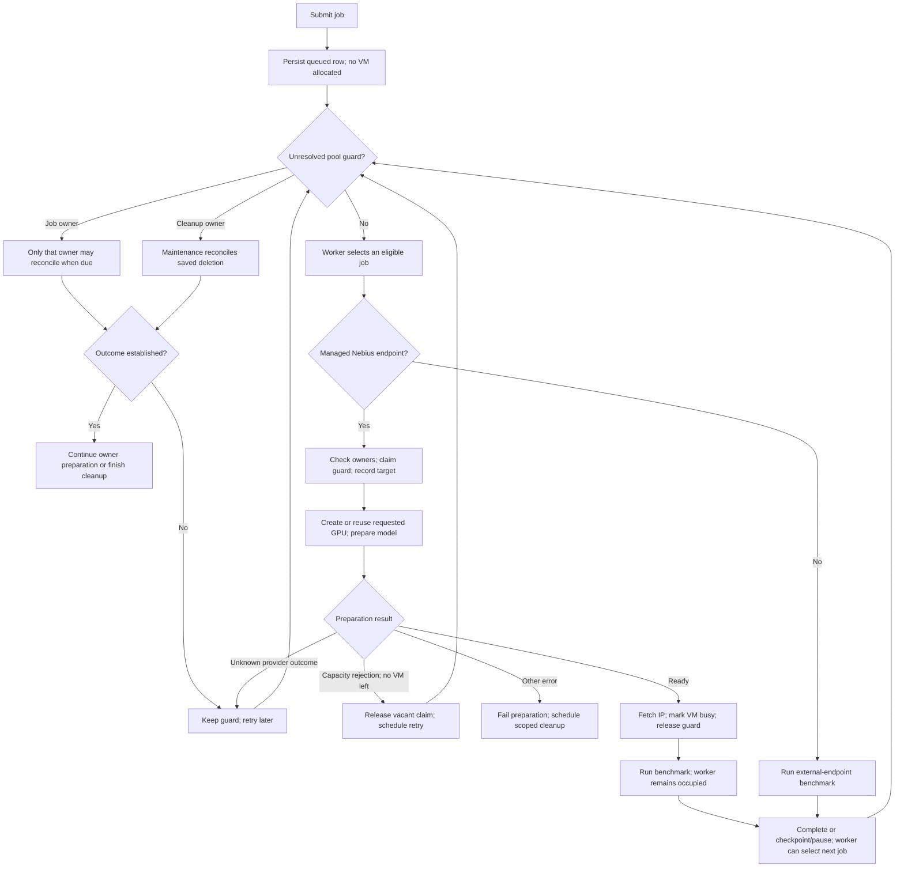
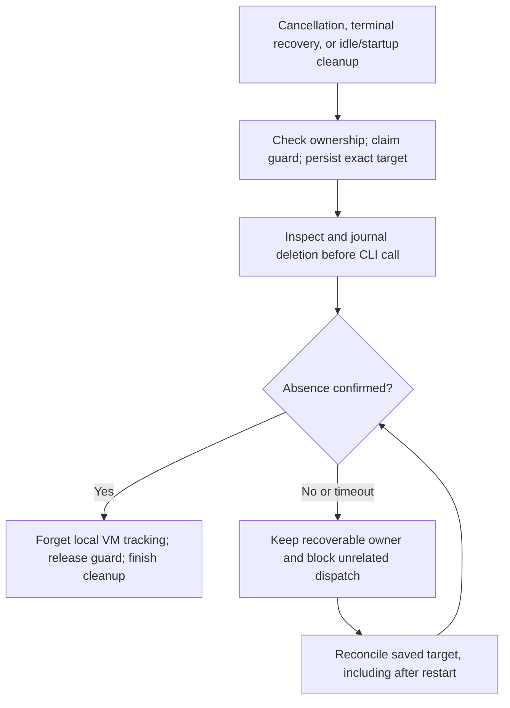
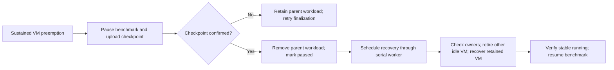

# Nebius queue workflow

This visual guide describes the capacity, ownership, and recovery behavior in
[PR #122](https://github.com/redhat-et/coding_agent_bench/pull/122), through
implementation commit `fb81ab6`. Deploy a queue image containing that change
before using its regional-discovery settings or pool-recovery endpoints.

For initial credentials and SSH setup, see [Nebius setup](nebius.md).

## One job at a time

Submitting a job saves it in the queue; it does not allocate a VM. The serial
worker selects an eligible job before checking or acquiring its hardware.



The **pool guard** and **serial worker** serve different purposes:

| Control | What it prevents |
|---|---|
| Durable pool guard | Unrelated work while a provider operation is unresolved, including external-endpoint jobs |
| Serial worker | A second benchmark or queued-job allocation while the selected benchmark is running |

The successful provisioning guard is released after the VM/model is ready and
marked busy, just before benchmark execution. That release does **not** start a
background search for the next job's GPU.

## Capacity rejection versus a lost response

**Confirmed capacity rejection:** if no VM remains, CAB clears the job's claim,
persists a retry deadline and count, and lets another eligible job proceed.
There is no capacity retry limit. The default 60 seconds is a minimum delay:
if another benchmark is running when it expires, the waiter stays queued.

**Lost create/start response:** a timeout means CAB stopped waiting, not that
Nebius cancelled the operation. The saved project and deterministic VM name
identify the target; its IP is fetched later.

```mermaid
sequenceDiagram
    participant Worker
    participant DB as SQLite
    participant Cloud as Nebius
    Worker->>DB: Save project/name and guard owner
    Worker->>DB: Journal create before sending it
    Worker->>Cloud: Create saved VM
    Cloud--xWorker: Response lost or timed out
    Worker->>DB: Retain uncertainty; schedule retry
    Note over Worker,Cloud: All unrelated dispatch waits
    Worker->>Cloud: Inspect saved project/name on retry
    alt VM found in stable state
        Cloud-->>Worker: VM details
        Worker->>Cloud: Ensure running; prepare model; obtain IP
        Worker->>DB: Release guard when preparation succeeds
    else NotFound, transitioning, or unreadable
        Worker->>DB: Keep guard; inspect again later
    end
```

Repeated `NotFound` after an uncertain create/start is not proof of failure.
There is no automatic uncertainty deadline that unlocks the pool. Confirmed
absence after a known deletion can settle cleanup.

### Optional regional fallback

Discovery lists approved projects and default subnets using the **queue service
account**. Targets must support the requested GPU family/count and pricing
policy. A round tries compatible regions sequentially:

```text
Region A: confirmed capacity rejection + no VM remains → try region B
Region A: unknown create/start outcome                → stop and reconcile A
All usable regions lack capacity                     → delay next round
```

Quota-only rounds, authentication errors and invalid configuration are not
endless physical-capacity retries. Regional quota failures may be skipped in
favor of another region. A generic `RESOURCE_EXHAUSTED` alone is insufficient
to classify a capacity shortage.

## Reuse, ownership, and cleanup

| Selected job needs | Behavior |
|---|---|
| Same GPU and same model on a still-running idle VM | Reuse VM and model server |
| Same GPU, different model | Reuse VM; replace the model container |
| Same GPU/model, but idle VM stopped or restarted | Invalidate model readiness; start the server again |
| Different GPU | Retire incompatible unowned idle VM before allocating replacement |

An idle cache can remain billable for the configured 600-second retention
period. This reuse policy predates the capacity changes.

### Who owns a VM?

| Durable job state | Interpretation |
|---|---|
| Actual saved placement | Claim that exact project/name |
| Confirmed vacant attempt | No VM claim, even for a resume/checkpoint job |
| New terminal-job resume with `nebius_location_hint` | Optional reuse preference; no exclusive claim until dispatch |
| Older recovery row without placement or hint | Conservatively protect the legacy VM |
| Paused job with a retained VM | Preserve its ownership during recovery |

Two resumes of a completed run may queue together. Both can prefer its old VM,
but only the selected job records an actual claim before provider mutation.
They cannot block each other with duplicate inherited claims. Hints survive
restart; older rows keep conservative ownership on migration. A failed
checkpoint's real claim transfers only to its exclusively claimed resume.

A paused job may retain a **stopped** cache. Regional mode can use a different
target beside it; single-project mode keeps its fixed target reserved. Running,
transitioning, or unreadable owner VMs defer another managed allocation.
Before restarting a paused VM, CAB retires a different completed job's idle VM.

### Every deletion has a durable guard



Cancellation after a benchmark starts reacquires a cleanup guard, because its
provisioning guard was already released. A timed-out VM deletion is not abandoned
after a retry budget. Per-job cleanup never sweeps other regions.

Background cleanup uses `owner_kind: "cleanup"` and owner ID
`__nebius_pool_cleanup__`. Discovery is read-only; deletion rechecks worker
activity and ownership before each target.

**Deferred startup cleanup respects new warm caches:** if A completes at 10:05,
a delayed startup sweep at 10:06 must not delete its recently used VM. Once live
tracking exists, maintenance uses normal idle expiry (eligible around 10:15,
unless reused). It checks again after asynchronous discovery. A pending delete
is still reconciled first.

## Preemption, datasets, and storage



The default three automatic benchmark resumptions after preemption are separate
from unlimited capacity retry rounds. Failed checkpoint finalization preserves
the parent workload; exhausted automatic resumptions retain the checkpoint for
manual resume.

### A new resume pod needs the dataset again

The input dataset lives in the benchmark pod's **`emptyDir`**, not on the GPU
VM. A new resume pod downloads the pinned dataset commit again and restores
results/checkpoints from RustFS. Private or credential-required sources require
a fresh `X-GitHub-Token`; missing credentials prevent fresh allocation. Public
datasets submitted without a token can resume automatically.

If only the queue service restarts and the already-prepared benchmark pod
survives, CAB can adopt that same execution without downloading again. That is
existing-pod recovery, not creation of a new resume pod. Tokens remain memory-only.

### Model files are a different cache

Hugging Face weights persist on the GPU VM at `/home/.cache/huggingface`.
Stopping/removing a container does not remove those files or its Docker image.
The boot disk is 1.25 TiB; repeated model/image downloads can exhaust it.
There is no disk-space preflight or automatic model/image cache eviction.

A surfaced storage error, or expiry of the 30-minute model-readiness deadline,
enters preparation failure: mark `failing`, schedule guarded VM deletion, then
finish workload cleanup. This is asynchronous cleanup, not cache pruning and
automatic rerun of the failed job.

## Operator recovery

All pool endpoints use the queue's `X-API-Key` authentication:

| Endpoint | Effect |
|---|---|
| `GET /nebius/pool` | Read owner, kind, target, phase, operation and revision without cloud calls |
| `POST /nebius/pool/reconcile/<owner-id>` | Schedule the owning job, or wake cleanup maintenance; does not unlock |
| `POST /nebius/pool/resolve-absent/<owner-id>` | Audit verified absence and release the expected guard |

If a create/start never becomes visible, inspect its recorded project/name and
establish that **no VM exists and no provider operation remains pending**.
Provider operation IDs and idempotency keys are not persisted by this PR.

Only after that verification, use the revision from the GET response whose
target you inspected. Replace `123` with that revision:

```sh
curl -H "X-API-Key: $API_KEY" "$JOB_QUEUE_URL/nebius/pool"

curl -X POST -H "X-API-Key: $API_KEY" -H 'Content-Type: application/json' \
  "$JOB_QUEUE_URL/nebius/pool/resolve-absent/<owner-id>" \
  -d '{"expected_revision":123,"operator":"your-name","reason":"Provider confirmed absence; ticket/reference","confirmed_absent":true}'
```

Resolution requires no active worker or maintenance pass. Every guard owner,
target or operation write advances its revision, even for a new attempt at the
same VM name. HTTP 409 means re-inspect and verify again before resubmitting.

The SQLite audit retains the self-reported operator, reason, timestamp and old
guard. Queued jobs retry after the configured delay; cancellation still finishes
workload cleanup. Credential-required paused jobs remain paused for token-aware
manual resume. Resolving a different idle cleanup target preserves the recovering
job's retained VM.

## Deploying to stage

**Regional fallback requires a multi-region-capable service account with grants
in every approved target project.** The team's existing region-locked accounts
must be replaced or appropriately granted before discovery is enabled. They can
still support single-project capacity retries with discovery disabled.

| Setting | Default |
|---|---|
| `NEBIUS_CAPACITY_RETRY_SECONDS` | `60` |
| `NEBIUS_CLI_TIMEOUT_SECONDS` | `300` |
| `NEBIUS_MODEL_START_TIMEOUT_SECONDS` | `1800` |
| `NEBIUS_DISCOVER_REGIONS` | `0` — opt-in |
| `NEBIUS_PROJECT_NAME_PREFIX` | `default-` |
| `NEBIUS_REGIONS` | Unset — matching accessible projects; optional comma-separated allowlist |
| `NEBIUS_IDLE_TIMEOUT_SECONDS` | `600` |

1. Grant tenant project listing and per-target project/subnet/platform reads,
   compute lifecycle, networking and service-account attachment access. Verify
   discovery with the queue account, rather than an operator's local login.
2. Update `nebius-secret` with account credentials/IDs and approved project/region
   filters. Keep discovery disabled until access is ready.
3. Set the queue container image and `CODING_AGENT_BENCH_IMAGE` to a tested stage
   image containing PR #122. Restart to reload Secret environment values;
   preserve one replica and `Recreate` deployment strategy.
4. Preserve `/app/data` on `job-queue-pvc`, `JOB_STORE_PATH=/app/data/jobs.db`, and
   the SSH key files. SQLite migrations run automatically. Plan restarts around
   memory-only GitHub tokens.
5. Confirm SSH access from the queue and model-port 8000 access from benchmark
   pods to candidate VMs. No new Kubernetes RBAC, route, storage class or port
   is introduced by the capacity feature.

After permissions and the stage image are ready, run a controlled one-task job
with the intended GPU, inspect placement/guard state, and verify completion and
cleanup. Test failover when a real capacity rejection is available; discovery
alone does not prove allocation or failover. Live allocation, failover and rollout
   were not performed during this PR's local validation.

## Code and validation

| File | Responsibility |
|---|---|
| `api.py` | SQLite, HTTP, serial dispatch, job/checkpoint execution |
| `nebius_pool.py` | Ownership, guard coordination, reconciliation, single-project lifecycle |
| `nebius_utils.py` | Provider calls, mutation journal events, regional discovery/routing |

Implementation revision `fb81ab6` passed **763 tests + 16 subtests**, Ruff and
diff checks. Provider/OpenShift tests use mocks. Regression coverage includes
lost responses, cancellation and restart, stale operator revisions, paused
ownership, deferred startup cleanup, model restarts, dataset credentials, and
multiple resumes processed by the real serial worker.
